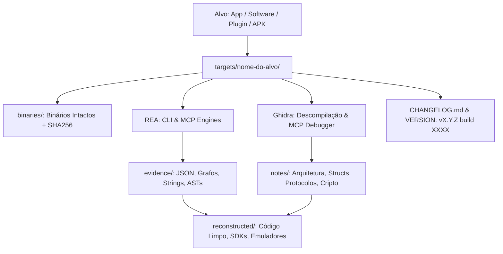

# 🔬 REA - Workspace de Engenharia Reversa

Plataforma unificada para **Engenharia Reversa de Software, Aplicativos, Plugins e Firmwares**, combinando o motor de evidências **[REA (Reverse Engineer Anything)](https://github.com/morluto/rea)** com a potência analítica do **Ghidra** (via Ghidra MCP e CLI local).

Projetado para transição e colaboração contínua e sem atritos entre **Google Antigravity**, **Claude Code** e **OpenAI Codex**.

---

## 🏛️ 1. Arquitetura do Workspace



---

## 📂 2. Estrutura de Diretórios

```text
d:\REA - ENGENHARIA REVERSA\
├── .rules/                     # Regras fundamentais e metodologias
│   ├── RE_METHODOLOGY.md       # Metodologia de RE, clean-room e análise baseada em evidências
│   ├── TARGET_SPEC.md          # Especificação detalhada da estrutura de pastas de cada alvo
│   ├── VERSIONING_CHANGELOG.md # Padrão vX.Y.Z (build XXXX) e regras de commit
│   └── MULTI_IDE_HANDOFF.md    # Protocolo de transição entre Antigravity, Claude e Codex
├── AGENTS.md                   # Diretrizes universais lidas por qualquer IA/agente
├── CLAUDE.md                   # Contexto e instruções específicas para Claude Code
├── GEMINI.md                   # Contexto e instruções específicas para Antigravity/Gemini
├── README.md                   # Este documento
├── CHANGELOG.md                # Changelog global do workspace
├── VERSION                     # Versão global atual
├── targets/                    # DIRETÓRIO DE TODOS OS ALVOS (Isolamento total!)
│   ├── _template/              # Blueprint inicial para novos alvos
│   └── (alvos criados)...
└── tools/                      # Automações e scripts do workspace
    ├── new-target.ps1          # Criação instantânea de novo alvo a partir do template
    └── bump-version.ps1        # Automação do versionamento e changelog
```

---

## 🚀 3. Como Criar um Novo Alvo de Análise

Cada app/software/plugin **DEVE** ter seu diretório exclusivo sob `targets/`.
Para criar um novo alvo padronizado com todos os arquivos e pastas estruturados, execute no PowerShell:

```powershell
.\tools\new-target.ps1 -TargetName "meu_software" -Description "Análise do plugin XYZ"
```

Isso gerará a pasta `targets/meu_software/` contendo:
* `binaries/`: Coloque os arquivos originais aqui e preencha `SHA256SUMS.txt`.
* `evidence/`: Saídas do REA (`--json`), logs e relatórios.
* `ghidra/`: Scripts Ghidra e mapas de memória.
* `notes/`: Caderno estruturado de notas (`01_overview.md`, `02_architecture.md`, `03_protocols_apis.md`, `04_crypto_security.md`).
* `scripts/`: Scripts auxiliares de unpacking/testes.
* `reconstructed/`: Código reconstruído limpo.
* `CHANGELOG.md` e `VERSION`: Versionamento próprio do alvo.

---

## 🛠️ 4. Fluxos de Trabalho com REA & Ghidra

### 4.1. Análise de Aplicativos Electron / JavaScript / Node.js
```powershell
# Extrai visão geral de módulos, limites IPC e imports
npx -y rea-agents analyze-javascript-application "caminho/do/app" --json
```

### 4.2. Análise de Binários Nativos (PE / ELF / Mach-O) via REA + Ghidra
```powershell
# Análise de inventário e símbolos usando motor Ghidra headless
npx -y rea-agents analyze "targets/<alvo>/binaries/arquivo.exe" --provider ghidra --json
```

### 4.3. Ghidra MCP no Antigravity
Ferramentas ativas para depuração e inspeção dinâmica no Antigravity:
* `connect_instance`: Conecta à sessão ativa do Ghidra.
* `import_file`: Importa binário para o projeto Ghidra.
* `debugger_read_memory` / `debugger_registers`: Inspeção de memória e registradores.
* `debugger_set_breakpoint` / `debugger_trace_function`: Breakpoints e tracing de funções.

---

## 📦 5. Sistema de Versionamento e Commits

Cada alvo e o workspace seguem a regra:
* **Formato**: `vX.Y.Z (build XXXX)` (ex: `v1.2.0 (build 1042)`)
* **Commits Obrigatórios**: `tipo: descrição` (`feat`, `fix`, `improve`, `perf`, `refactor`, `break`)
* **Incremento Automático**:
  - `break` → incrementa X, zera Y e Z.
  - `feat` → incrementa Y, zera Z.
  - outros (`fix`, etc.) → incrementa Z.
  - `build` sempre incrementa +1.

Para calcular e atualizar a versão de um alvo:
```powershell
.\tools\bump-version.ps1 -Target "meu_software" -Type "feat" -Message "Mapeado protocolo de rede"
```

---

## 🤝 6. Protocolo Multi-IDE (Antigravity ↔ Claude Code ↔ Codex)
Ao pausar ou finalizar uma sessão em qualquer IDE:
1. Atualize a seção `## 📍 3. Estado Atual e Próximos Passos` no `README.md` do alvo.
2. Salve evidências e dumps em `evidence/` (nunca deixe dados cruciais apenas no chat).
3. Atualize o `CHANGELOG.md` do alvo com as novas descobertas.
