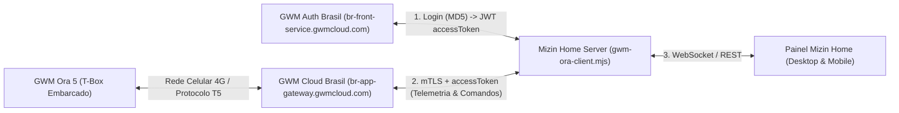

# 02 - Arquitetura da Nuvem GWM Brasil e Fluxo de Dados

## 1. Topologia de Comunicação
O veículo GWM Ora possui um módulo telemático embarcado (**T-Box / T5**) com chip celular (eSIM/IMSI próprio) que envia periodicamente snapshots de barramento CAN para a nuvem regional da GWM no Brasil (`*.gwmcloud.com`).

## 2. Fluxo de Controle
1. **Autenticação (`auth()`)**:
   - Gera um `deviceid` persistente (32 chars hex / MD5).
   - Envia `account` (e-mail/telefone do My GWM) e `password` em hash `MD5(senha)` para `https://br-front-service.gwmcloud.com/br-official-commerce/br-official-gateway/pc-api/api/v1.0/userAuth/loginAccount`.
   - Recebe `accessToken` e `refreshToken` (tokens JWT).
2. **Descoberta da Garagem (`acquireVehicles`)**:
   - Com canal mTLS estabelecido (`gwm_general.cer` + `gwm_general.key`), consulta `GET /globalapp/vehicle/acquireVehicles`.
   - Retorna a lista de veículos vinculados à conta (`vin`, `appShowSeriesName`, `color`, `staticImageUrl`, `powerType`, `imsi`, `simIccid`).
3. **Polling de Telemetria (`getLastStatus`)**:
   - Consulta `GET /vehicle/getLastStatus?vin=<VIN>&flag=true`.
   - Retorna latitude/longitude, timestamps de atualização (`acquisitionTime`, `updateTime`) e o array `items: [{ code, value, unit }]` com todos os sensores do carro.
4. **Execução de Comandos Remotos (`T5/sendCmd`)**:
   - Envia instruções hexadecimais (`0x04` A/C, `0x05` Travas, `0x08` Janelas/Teto Solar, `0x09` Porta-malas) autenticadas com `securityPassword: MD5(PIN)` e `seqNo` único.
   - O resultado assíncrono do comando na T-Box é acompanhado via `GET /vehicle/getRemoteCtrlResultT5?seqNo=<seqNo>&vin=<VIN>`.
