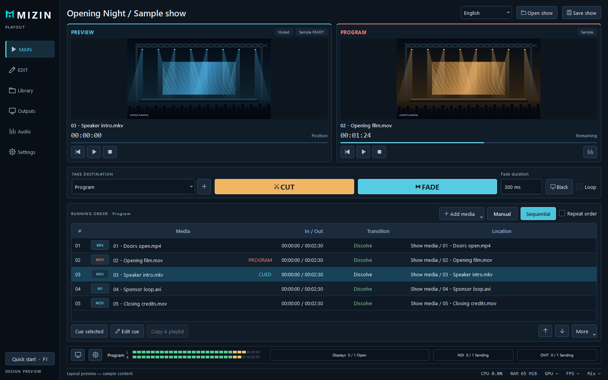
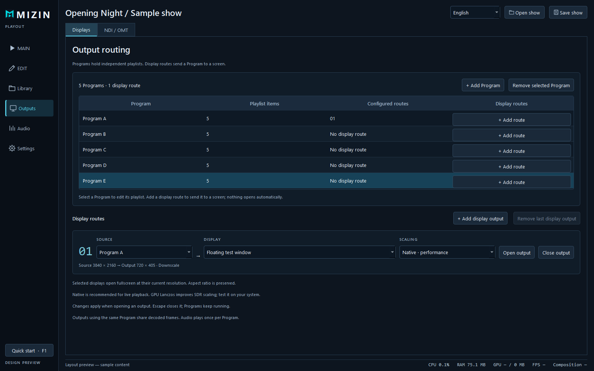
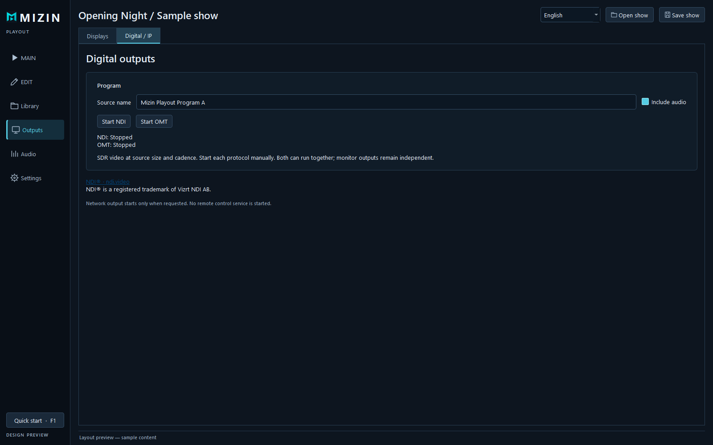
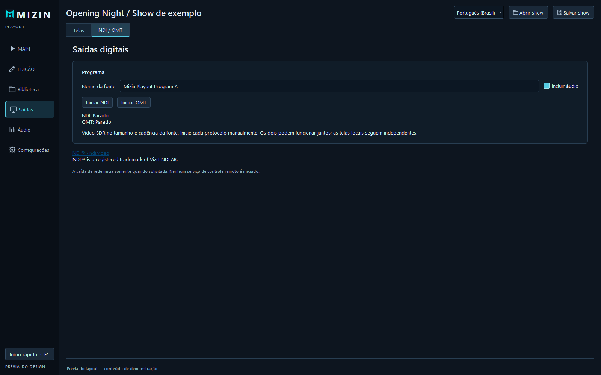
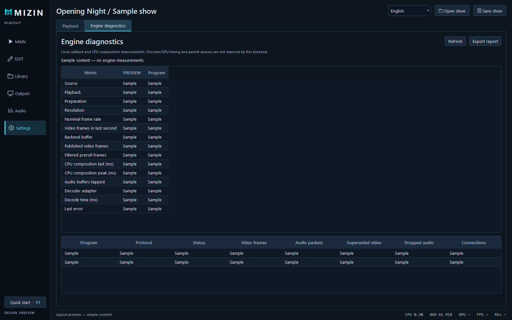

# Mizin Playout

**Native media playback. Independent Programs. Shared outputs.**

Original C++20 desktop application under active development. English is the default language; Português (Brasil) can be selected at runtime. This product is independently implemented from our requirements; it does not reuse Azimuth, ffplayout or CasparCG implementation code or artwork. See the [reference study](docs/reference-study.md).

## Current slice

- Native Qt 6.10.2 / FFmpeg playback, without browser video or mandatory conversion.
- Paused, muted Preview and one Program by default. Additional Programs allocate native channels on demand, each with its own applied playlist and transport.
- MAIN follows approved **A — Live Desk**: Program selector and all-Program multiview, per-Program running order and aggregate audio/output dashboard. CUT / FADE remain explicit; FADE defaults to 300 ms.
- Minimal controls: aligned 40px TAKE row, stable Manual/Sequential typography, Add media imports, reorder arrows and More for secondary cue actions.
- Persistent usage footer: background-sampled process CPU/RAM/optional GPU engine, selected Program frame publications and last CPU transition composition time (Composition). Missing/stale measurements remain unavailable.
- EDIT: shared muted Preview, In/Out, per-item sequence transitions and explicit Apply / Reset controls.
- Source READY: file/readability, duration, applied In/Out and a decoded Preview frame in range are verified before manual takes. Changed sources and stale requests invalidate the proof; Preview remains muted and EDIT can scrub the full file. Programs still prepare their own decks on TAKE.
- Settings → Engine diagnostics: live channel/preparation states, frame publications, Qt buffer progress, CPU composition timing, NDI/OMT counters and local JSON export. Unavailable decoder/GPU metrics remain explicitly unavailable.
- Two decks per Program: muted preroll at In before switching; preserve current Program if incoming media fails.
- Outputs inventory lists every Program, its playlist size and configured routes. **+ Add route** binds a new closed route to that Program; Programs and screens are counted separately.
- Dynamic display routes: mirror A or choose another Program, with fullscreen screen selection, current-mode/DPI sizing and aspect-preserving fit.
- Native live scaling by default; optional GPU Lanczos SDR and experimental CPU Lanczos profiles.
- Screen menu refresh and output close on display disconnection; reopening replaces only that route.
- Independent Program audio: master gain, mute, local monitor enable, detected output-device routing and L/R peak meters.
- NDI / OMT outputs: manually started NDI® and OMT senders for each Program, including stereo 48 kHz audio. Both protocols can run together alongside display outputs. [About NDI](https://ndi.video/).
- Mirror live Program playback, or copy A into an empty independent playlist. Copying never overwrites an existing list.
- Native file/folder import and OS drag/drop; background recursive folder discovery.
- Per-item In/Out with millisecond fields, scrub/Mark In/Mark Out, duplication and reordering.
- Cut, Dissolve and Fade through black between clips; entry/exit fades for a standalone clip.
- Manual or sequential playback, repeat order, current-range loop and black per selected Program.
- Schema-4 show persistence for stable Program IDs/names, independent playlists and route sources; schema-1/2/3 migration. Busy Program/open-route removal is blocked.
- English and PT-BR catalogs, language switching without rebuilding the playback engine.
- Native F1 help and [English quick start](docs/quick-start.en.md) / [Início rápido PT-BR](docs/quick-start.pt-BR.md).

Container extension alone does not establish compatibility. The QA matrix includes H.264 MP4/MKV, H.265 MP4, MJPEG AVI and ProRes MOV, plus separate H.264 1080p and UHD 4K fixtures. Validation results are recorded under evidence/ after execution; no universal codec or performance claim is made.

## Native interface boards

Generated by the executable with clearly marked sample content. Direction A was selected by the user; these native captures show its implementation for visual review and are separate from playback/performance evidence. See the [approval record](design/APPROVAL.md) and [board review](design/REVIEW.md).

## Run on the development machine

After building, open dist/MizinPlayout.exe or Start Mizin Playout.cmd. The development folder remains local. Private preview Setup/ZIP artifacts are generated under releases/; they are unsigned and not published.

PowerShell commands from this target:

- scripts/build.ps1 — commit-driven version, CMake/MSVC build and local Qt deployment.
- scripts/setup-packaging.ps1 — verify/extract the pinned target-private NSIS compiler.
- scripts/package.ps1 — assemble immutable Windows Setup/ZIP from the existing successful automatic version.
- scripts/test-package.ps1 -ShellRegistration — relocate, play media, install/reinstall/remove and check the current-user shortcut/registry entry.
- scripts/run.ps1 — native application; optional -Language pt-BR, -Cpu or -Board.
- scripts/capture-boards.ps1 — twelve full-size native layout PNGs, including Engine diagnostics; -MultiOutput exports the three-Program / five-route sample configuration to an alternate -Directory. Compact MAIN can be captured separately.
- scripts/make-fixtures.ps1 -FFmpeg <QA-tool-path> — generated test clips.

The build requires MSVC/CMake, the target-private Qt SDK and Python for build orchestration. The executable itself does not require Python or Node.js. SDK/QA tools live in ignored binaries/; compiled outputs live in ignored build/ and dist/; versioned private artifacts live in ignored releases/. Dependencies and source obligations are tracked in [THIRD_PARTY.md](docs/THIRD_PARTY.md).

## Versioning

scripts/version.py reads actual target Git commits since the recorded source commit, including BREAKING CHANGE bodies. It computes major/minor/patch, advances the build counter, generates all changelog sections with commit hashes and records build PASS/FAIL. No manual semantic-version parameter is accepted. VERSION and evidence/build-version.json are generated before compilation.

## Estado Atual e Próximos Passos

**Build 0049 (v0.18.4, 2026-10-22) — release candidate for the first public update feed:** low-latency audio engine (ADR-018, WASAPI; ASIO only in local builds with -DMIZIN_ENABLE_ASIO=ON until a Steinberg agreement is signed), detachable decks, web monitor, and an installer that no longer needs administrator rights (app-local Microsoft CRT; a beta tester's Setup had aborted on the elevated runtime step while the portable ZIP worked). Package PASS 44 checks (UI 101, web 18, audio engine 17 incl. VB-Cable loopback, readiness, smoke), update handoff PASS 11. NDI external probes are host-state dependent (0044 fails identically under the same conditions; see ISSUE-001). Builds 0045/0047/0048 superseded (see build-history). **Not yet published**: `scripts/updates.py publish` (R2 `playout/` prefix) and the presentation site in `site/` (Cloudflare Pages project `playoutmizin` → playoutmizin.pages.dev, `scripts/site.py` writes assets/release.json) both await explicit approval to deploy.

**Build 0044 (v0.17.0, 2026-10-22) — monitor web WebRTC (ADR-017):** Outputs → Web monitor serves a view-only page (LAN or this computer only, access code, off by default). Each watched Program has one 1280×720 H.264 encoder (Windows Media Foundation) + Opus stereo shared by all viewers. Package PASS (40 checks: native UI 97, web 18, readiness 24, smoke 7), update handoff PASS (11), external NDI/OMT probes PASS ×3 on an idle host. Browser check (built-in Chromium, same PC): 1280×720 at 29 fps, 4–21 ms video jitter buffer, stereo Opus. Dependencies: `scripts/build-web-sdk.cmd` (libdatachannel 0.24.6, Mbed TLS 3.6.7, Opus 1.5.2), notices in `packaging/notices/webrtc-monitor`. Not yet measured: glass-to-glass latency on a phone over Wi-Fi/LAN. **Next:** ADR-018 low-latency audio (WASAPI exclusive first; ASIO after the Steinberg licence decision).

**Build 0043 (v0.16.1, 2026-10-21) — decks destacáveis + NO AR (ADR-016):** every deck (Preview, Program, multiview Programs) can open in its own window (another monitor, F11 fullscreen, close to dock) reusing the Program's frames; Programs with media on air get a red bar and ON AIR badge. Package PASS (38 checks, native UI 95 checks including 8 new deck/tally checks), update handoff PASS (11). Boards: `evidence/deck-window-0043.png`, `evidence/deck-docked-0043.png`. Build 0042 failed before compiling because of how build.ps1 was invoked (recorded in build-history). **Next (agreed order):** ADR-017 local WebRTC view-only monitor, then ADR-018 low-latency audio (ASIO for Dante VSC / Behringer UMC / Blackmagic + WASAPI exclusive; Steinberg ASIO SDK licence must be accepted first). Still open: NDI/OMT audio probes on an idle machine (see build 0041 note) and publishing the signed update feed (needs explicit approval).

**Build 0041 (v0.15.5, 2026-10-21):** package `releases/MizinPlayout-0.15.5-build0041-windows-x64-preview` (setup + portable). Package validation PASS (38 checks, `evidence/package-validation-0041.json`). Update handoff PASS (11 checks, `evidence/update-install-0041.json`) after the test was made to wait for the restarted window; the first attempt is kept in `update-install-0041-attempt1.json`. External NDI probes: frame order clean in all three runs, but each run is FAIL on network audio mute/OMT audio timing while the host was under heavy render load (see ISSUE-001); repeat on an idle machine. **The signed update feed has not been published yet** (`playout/preview/latest.json` returns 404); publishing to Cloudflare is a separate, explicit step (`scripts/updates.py prepare|publish`).

Windows x64 private preview **v0.14.1 (build 0035)** now produces a per-user Setup EXE and portable ZIP in `releases/MizinPlayout-0.14.1-build0035-windows-x64-preview`. The EXE embeds the approved original icon and automatically generated version. Normal settings use AppLocalDataLocation; --portable uses adjacent state/ and --state-dir overrides both. Packaging excludes developer state/fixtures/SDKs, includes the signed official VC++ redistributable, Qt/FFmpeg/OMT runtime and dependency notices/SBOMs, and retains original app source plus file hashes. NDI remains a separately installed optional official runtime. **39 package checks and 114 relocated native checks passed**, including actual Windows shortcut/uninstall registration, reinstall/removal preservation and UI/readiness/codec playback outside the developer PATH. The complete 446-check regression belongs to historical build 0033; current package qualification is narrower. Build 0034's initial isolated package checks passed, but its installer had quote warnings and was superseded by this corrected, zero-warning build. The minimal layout, MB/GB footer, independent Programs and multiview remain intact. **Unsigned private preview; clean Windows, missing-runtime UAC, complete dependency-source rebuild and physical output/AV-sync qualification remain pending. ISSUE-001 remains open.** See [current validation](evidence/validation.json), [package record](evidence/windows-preview-0035.md), [release gates](docs/release-roadmap.md) and [packaging architecture](notes/ADR-014-windows-preview-packaging.md).

Each manual CUT/FADE starts a snapshot of the current running order for that Program. CUT bypasses the entry fade for that launch. FADE uses its manual duration (300 ms by default) and also fades from black. Saved cue transitions remain intact for automatic/repeated playback. Editing fields are applied explicitly in EDIT; manual buttons use the applied model. Switching pages does not recreate or stop the channels. Ctrl+Enter triggers CUT and Ctrl+Space triggers FADE in MAIN only. Further applied edits affect the next launch. Manual playback holds at Out (or ends on black with an exit fade). Sequential playback prepares the next item and uses its transition, with an optional repeat order. A next item that is late waits at the boundary; a failed item reports an error and stops advance. Fades are clamped on short segments. Trim is not a destructive file operation; backend seeking and timing have not been qualified as broadcast frame/sample accuracy.

Automatic hardware decoding and forced CPU decoding remain available. Normal cuts/Native outputs share native frames; transitions still use a CPU image compositor once per Program. Outputs now offer **Native**, **Lanczos GPU (SDR)** and **experimental Lanczos CPU**. The GPU profile shares input conversion per Program, then filters/presents textures directly on each output; it is not zero-copy. Native fallback preserves high-depth/HDR/transformed/subtitle frames and handles graphics-resource failure. See [GPU architecture and validation](notes/ADR-005-gpu-lanczos.md).

Historical **build 0020** four-second automatic-decoder runs measured **1.66 ms GPU filter / 27.09 fps** for 4K→1080p and **2.31 ms / 29.16 fps** for 1080p→4K. Input readback/upload remains a cost; Native stays the live default. The detected desktop was SONY TV 1920×1080 / 60 Hz, so the 4K framebuffer was not physical 4K-monitor proof. AMD/Intel renderers, hardware decoder profiles by GPU, HDR/alpha/color, physical display synchronization and production AV-sync remain open. Historical D3D11 decoder selection evidence is retained separately and does not identify a decoder adapter.

The in-process native widget checks passed. The MAIN layout uses native widgets, original vector icons, aspect-fitting media views and filename elision/tooltips. Its audio/output dashboard observes actual channel/route/publisher state; clicking a status tile opens settings without starting a sender. Previous native boards and the build-0020 executable were preserved. The A concept direction was approved; final native visual review remains with the user. Earlier Windows accessibility and fullscreen-geometry checks are historical; OS pointer/drag-drop interaction, hotplug and physical-output visual/signal validation remain unverified for this build. Native layout samples do not prove physical playback.

The **Audio** page provides independent master volume/mute for enabled Programs, local monitor enable, device routing and peak meters. Local monitoring can be off while network audio continues. Missing selected endpoints mute the local path. **Outputs → NDI / OMT** provides named, manually started NDI/OMT publishers per Program; both protocols can run together. Network audio is stereo 48 kHz; source size/cadence is preserved on Black. NDI uses the installed official runtime and OMT native libraries are included in the development package. No active sender is restored automatically. See [audio/network design and validation](notes/ADR-006-audio-network-outputs.md) and the [Portuguese operator guide](docs/quick-start.pt-BR.md).

Windows is the first validation platform. macOS/Linux builds, authenticated remote control, scheduling/24-hour operation, relink/autosave and production qualification remain future work. Programs/routes are now dynamic. Defensive allocation guards are 64 Programs / 128 routes; the current playback proof is three Programs and five floating windows, with five-Program multiview/layout checks, not a concurrency or physical-output rating. Every launch defaults to one of each until a saved show is opened.

Architecture decision: [ADR-001](notes/ADR-001-native-engine.md). This is a native application; a later web surface is for remote operation.

NDI® is a registered trademark of Vizrt NDI AB. SDK/runtime dependency provenance and distribution scope are recorded in [THIRD_PARTY.md](docs/THIRD_PARTY.md).
