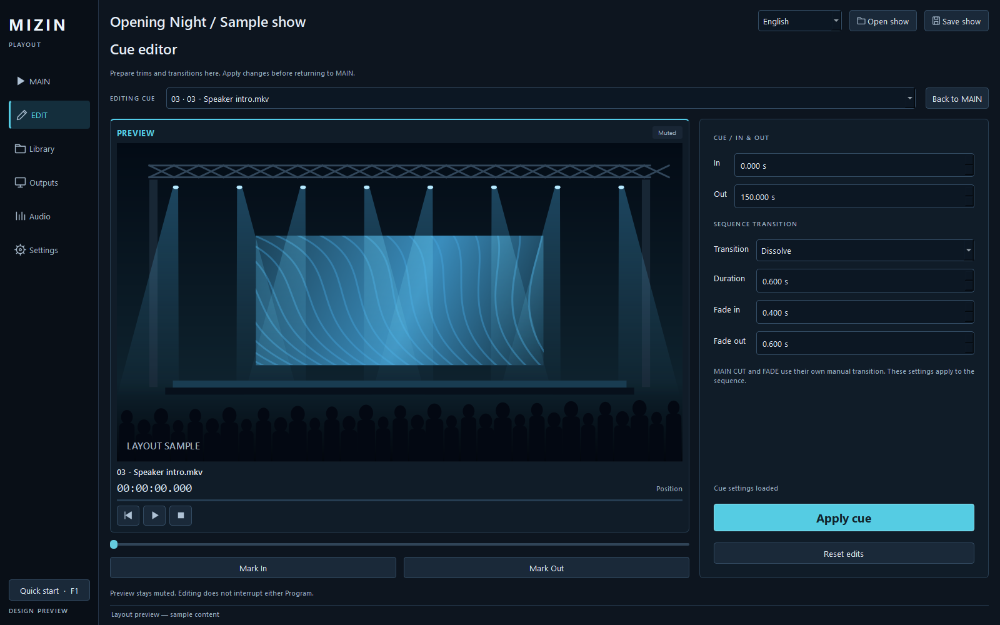
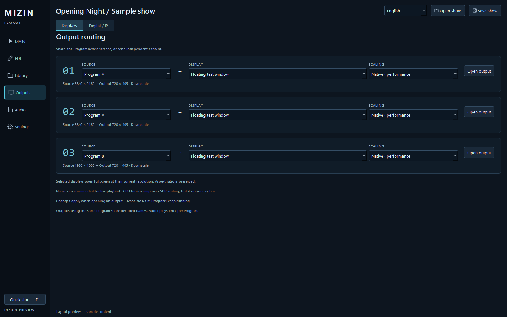
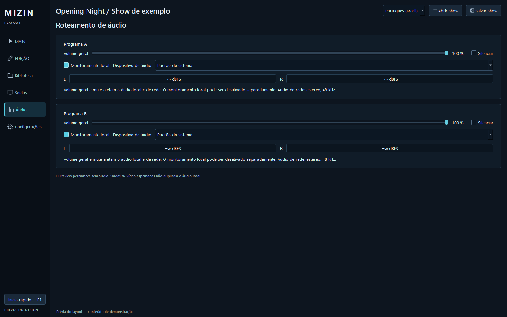

# Mizin Playout

**Native media playback. Independent Programs. Shared outputs.**

Original C++20 desktop application under active development. English is the default language; Português (Brasil) can be selected at runtime. This product is independently implemented from our requirements; it does not reuse Azimuth, ffplayout or CasparCG implementation code or artwork. See the [reference study](docs/reference-study.md).

## Current slice

- Native Qt 6.10.2 / FFmpeg playback, without browser video or mandatory conversion.
- Paused, muted Preview and two independent logical Programs (A/B).
- MAIN follows the approved **A — Live Desk** direction: proportional monitors, segmented A/B destination and Manual/Sequential controls, a shared running order and a live audio/output dashboard. CUT / FADE remain explicit; FADE defaults to 300 ms and remembers its duration.
- EDIT: shared muted Preview, In/Out, per-item sequence transitions and explicit Apply / Reset controls.
- Two decks per Program: muted preroll at In before switching; preserve current Program if incoming media fails.
- Three routes with explicit fullscreen screen selection, current-mode/DPI sizing and aspect-preserving fit.
- Native live scaling by default; optional GPU Lanczos SDR and experimental CPU Lanczos profiles.
- Screen menu refresh and output close on display disconnection; reopening replaces only that route.
- Independent Program audio: master gain, mute, local monitor enable, detected output-device routing and L/R peak meters.
- Digital / IP outputs: manually started NDI® and OMT senders for each Program, including stereo 48 kHz audio. Both protocols can run together alongside display outputs. [About NDI](https://ndi.video/).
- Mirror the same Program or select another Program for independent video.
- Native file/folder import and OS drag/drop; background recursive folder discovery.
- Per-item In/Out with millisecond fields, scrub/Mark In/Mark Out, duplication and reordering.
- Cut, Dissolve and Fade through black between clips; entry/exit fades for a standalone clip.
- Manual or sequential playback, repeat order, current-range loop and black per selected Program.
- Schema-2 show persistence for trim/transition metadata, with schema-1 migration.
- English and PT-BR catalogs, language switching without rebuilding the playback engine.
- Native F1 help and [English quick start](docs/quick-start.en.md) / [Início rápido PT-BR](docs/quick-start.pt-BR.md).

Container extension alone does not establish compatibility. The QA matrix includes H.264 MP4/MKV, H.265 MP4, MJPEG AVI and ProRes MOV, plus separate H.264 1080p and UHD 4K fixtures. Validation results are recorded under evidence/ after execution; no universal codec or performance claim is made.

## Native interface boards

Generated by the executable with clearly marked sample content. Direction A was selected by the user; these native captures show its implementation for visual review and are separate from playback/performance evidence. See the [approval record](design/APPROVAL.md) and [board review](design/REVIEW.md).

## Run on the development machine

After building, open dist/MizinPlayout.exe or Start Mizin Playout.cmd. The local executable is a development package, not a published installer.

PowerShell commands from this target:

- scripts/build.ps1 — commit-driven version, CMake/MSVC build and local Qt deployment.
- scripts/run.ps1 — native application; optional -Language pt-BR, -Cpu or -Board.
- scripts/capture-boards.ps1 — ten native layout PNGs.
- scripts/make-fixtures.ps1 -FFmpeg <QA-tool-path> — generated test clips.

The build requires MSVC/CMake, the target-private Qt SDK and Python for build orchestration. The executable itself does not require Python or Node.js. SDK/QA tools live in ignored binaries/; compiled outputs live in ignored build/ and dist/. Dependencies and source obligations are tracked in [THIRD_PARTY.md](docs/THIRD_PARTY.md).

## Versioning

scripts/version.py reads actual target Git commits since the recorded source commit, including BREAKING CHANGE bodies. It computes major/minor/patch, advances the build counter, generates all changelog sections with commit hashes and records build PASS/FAIL. No manual semantic-version parameter is accepted. VERSION and evidence/build-version.json are generated before compilation.

## Estado Atual e Próximos Passos

Windows native **v0.7.6 (build 0023)** implements the user's selected **A — Live Desk** layout and passed **174 current functional checks**: 19 UI, 7 baseline media/channel, 23 transport and 38 audio/network checks in each of CPU/automatic decoder modes. The UI suite covers both languages at 1600×1000 and 1280×800, destination-specific modes, CUT/FADE, editor isolation, persistence and output-settings navigation. Twelve native boards, eight fixture hashes, four version-policy tests and 213 matched EN/PT-BR catalog keys were checked. See [current validation evidence](evidence/validation.json) and the [Live Desk validation record](evidence/live-desk-0023.md). Earlier GPU/output measurements remain in [build-0020 evidence](evidence/validation-build-0020.json); they were not rerun as performance claims for this layout change.

Each manual CUT/FADE starts a snapshot of the current running order for that Program. CUT bypasses the entry fade for that launch. FADE uses its manual duration (300 ms by default) and also fades from black. Saved cue transitions remain intact for automatic/repeated playback. Editing fields are applied explicitly in EDIT; manual buttons use the applied model. Switching pages does not recreate or stop the channels. Ctrl+Enter triggers CUT and Ctrl+Space triggers FADE in MAIN only. Further applied edits affect the next launch. Manual playback holds at Out (or ends on black with an exit fade). Sequential playback prepares the next item and uses its transition, with an optional repeat order. A next item that is late waits at the boundary; a failed item reports an error and stops advance. Fades are clamped on short segments. Trim is not a destructive file operation; backend seeking and timing have not been qualified as broadcast frame/sample accuracy.

Automatic hardware decoding and forced CPU decoding remain available. Normal cuts/Native outputs share native frames; transitions still use a CPU image compositor once per Program. Outputs now offer **Native**, **Lanczos GPU (SDR)** and **experimental Lanczos CPU**. The GPU profile shares input conversion per Program, then filters/presents textures directly on each output; it is not zero-copy. Native fallback preserves high-depth/HDR/transformed/subtitle frames and handles graphics-resource failure. See [GPU architecture and validation](notes/ADR-005-gpu-lanczos.md).

Historical **build 0020** four-second automatic-decoder runs measured **1.66 ms GPU filter / 27.09 fps** for 4K→1080p and **2.31 ms / 29.16 fps** for 1080p→4K. Input readback/upload remains a cost; Native stays the live default. The detected desktop was SONY TV 1920×1080 / 60 Hz, so the 4K framebuffer was not physical 4K-monitor proof. AMD/Intel renderers, hardware decoder profiles by GPU, HDR/alpha/color, physical display synchronization and production AV-sync remain open. Historical D3D11 decoder selection evidence is retained separately and does not identify a decoder adapter.

The in-process native widget checks passed. The MAIN layout uses native widgets, original vector icons, aspect-fitting media views and filename elision/tooltips. Its audio/output dashboard observes actual channel/route/publisher state; clicking a status tile opens settings without starting a sender. Previous native boards and the build-0020 executable were preserved. The A concept direction was approved; final native visual review remains with the user. Earlier Windows accessibility and fullscreen-geometry checks are historical; OS pointer/drag-drop interaction, hotplug and physical-output visual/signal validation remain unverified for this build. Native layout samples do not prove physical playback.

The **Audio** page provides independent A/B master volume/mute, local monitor enable, device routing and peak meters. Local monitoring can be off while network audio continues. Missing selected endpoints mute the local path. **Outputs → Digital / IP** provides named, manually started NDI/OMT publishers per Program; both protocols can run together. Network audio is stereo 48 kHz; source size/cadence is preserved on Black. NDI uses the installed official runtime and OMT native libraries are included in the development package. No active sender is restored automatically. See [audio/network design and validation](notes/ADR-006-audio-network-outputs.md) and the [Portuguese operator guide](docs/quick-start.pt-BR.md).

Windows is the first validation platform. macOS/Linux builds, authenticated remote control, scheduling/24-hour operation, relink/autosave and production qualification remain future work. Two logical Programs and three route rows are a bounded first proof.

Architecture decision: [ADR-001](notes/ADR-001-native-engine.md). This is a native application; a later web surface is for remote operation.

NDI® is a registered trademark of Vizrt NDI AB. SDK/runtime dependency provenance and distribution scope are recorded in [THIRD_PARTY.md](docs/THIRD_PARTY.md).
