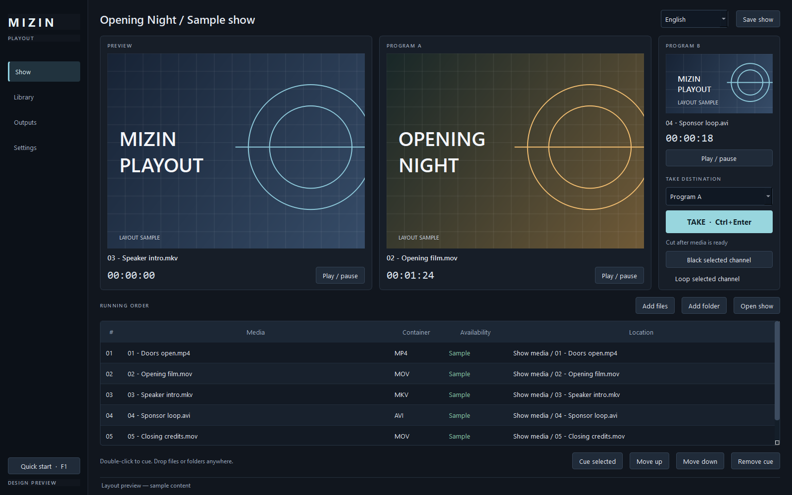
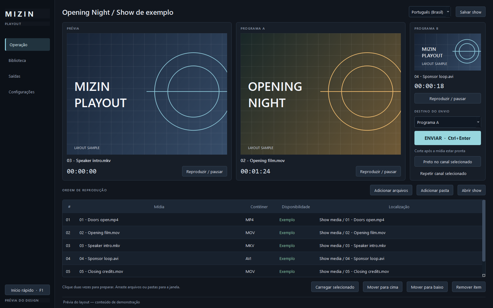

# Mizin Playout

**Native media playback. Independent Programs. Shared outputs.**

Original C++20 desktop application under active development. English is the default language; Português (Brasil) can be selected at runtime. This product is independently implemented from our requirements; it does not reuse Azimuth code or artwork.

## Current slice

- Native Qt 6.10.2 / FFmpeg playback, without browser video or mandatory conversion.
- Paused, muted Preview and two independent logical Programs (A/B).
- Two decks per Program: muted preroll before a cut; preserve current Program if incoming media fails.
- Three route rows: mirror the same Program or select another Program for independent video.
- Native file/folder import and OS drag/drop; background recursive folder discovery.
- Running-order selection/reordering, project save/open, loop and black per selected channel.
- English and PT-BR catalogs, language switching without rebuilding the playback engine.
- Native F1 help and [English quick start](docs/quick-start.en.md) / [Início rápido PT-BR](docs/quick-start.pt-BR.md).

Container extension alone does not establish compatibility. The QA matrix includes H.264 MP4/MKV, H.265 MP4, MJPEG AVI and ProRes MOV. Validation results are recorded under evidence/ after execution; no universal codec or performance claim is made.

## Native interface boards

Generated by the executable with clearly marked sample content. These are layout proposals, not playback/performance evidence.

## Run on the development machine

After building, open dist/MizinPlayout.exe or Start Mizin Playout.cmd. The local executable is a development package, not a published installer.

PowerShell commands from this target:

- scripts/build.ps1 — commit-driven version, CMake/MSVC build and local Qt deployment.
- scripts/run.ps1 — native application; optional -Language pt-BR, -Cpu or -Board.
- scripts/capture-boards.ps1 — four native layout PNGs.
- scripts/make-fixtures.ps1 -FFmpeg <QA-tool-path> — generated test clips.

The build requires MSVC/CMake, the target-private Qt SDK and Python for build orchestration. The executable itself does not require Python or Node.js. SDK/QA tools live in ignored binaries/; compiled outputs live in ignored build/ and dist/. Dependencies and source obligations are tracked in [THIRD_PARTY.md](docs/THIRD_PARTY.md).

## Versioning

scripts/version.py reads actual target Git commits since the recorded source commit, including BREAKING CHANGE bodies. It computes major/minor/patch, advances the build counter, generates all changelog sections with commit hashes and records build PASS/FAIL. No manual semantic-version parameter is accepted. VERSION and evidence/build-version.json are generated before compilation.

## Estado Atual e Próximos Passos

Windows native build passed. All 14 functional checks passed: five media formats, independent Programs/mirrored frame consumers, and continuity after invalid incoming media, in both automatic and CPU decoding modes. Fixtures are synthetic 640×360/30 fps clips; this is functional validation, not 1080p/4K or physical-output qualification. Four 1600×1000 native boards were reviewed, and the 84-entry English/PT-BR catalogs match. See [validation evidence](evidence/validation.json).

The Windows accessibility tree confirmed the default English interface. The external Windows capture tool timed out and pointer geometry was unavailable, so manual OS interaction/drag-drop and physical outputs remain unverified. The boards are exported by the application's native Qt renderer with clearly marked sample content. Human visual approval is pending.

Next: review the native boards, validate physical multi-display behavior and profile GPU/software paths. Then add a measured compositor/dissolve path, per-device audio, persistence recovery and remote control. Scheduling/24-hour operation follows event workflow.

Windows is the first validation platform. macOS/Linux builds, remote control, scheduling, dissolve, trim, relink/autosave and production qualification are **not delivered in this slice**. Two logical Programs and three route rows are a bounded first proof; physical capability and final output count require measurement.

Architecture decision: [ADR-001](notes/ADR-001-native-engine.md). This is a native application; the later web surface is for remote operation only.
