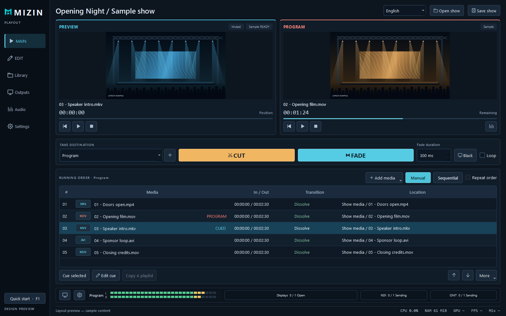
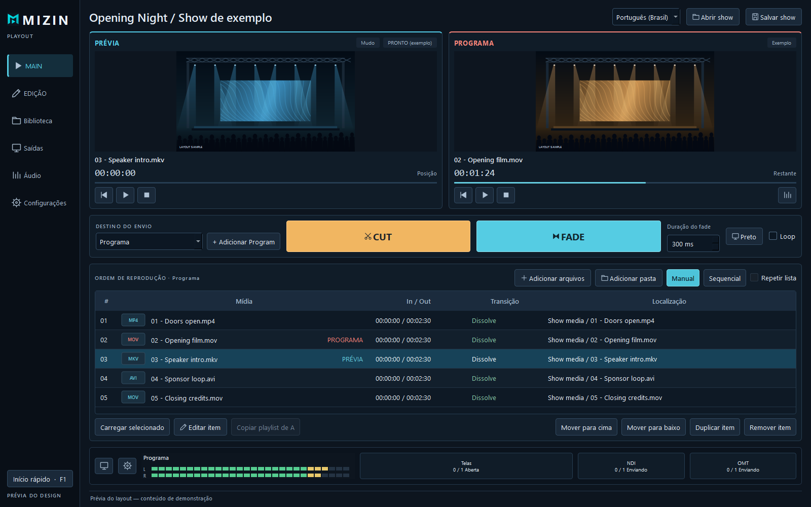

# Mizin Playout

**Native media playback. Independent Programs. Shared outputs.**

Original C++20 desktop application under active development. English is the default language; Português (Brasil) can be selected at runtime. This product is independently implemented from our requirements; it does not reuse Azimuth, ffplayout or CasparCG implementation code or artwork. See the [reference study](docs/reference-study.md).

## Current slice

- Native Qt 6.10.2 / FFmpeg playback, without browser video or mandatory conversion.
- Paused, muted Preview and two independent logical Programs (A/B).
- MAIN: independent monitors, running order and manual CUT / FADE controls. FADE defaults to 300 ms and remembers its duration.
- EDIT: shared muted Preview, In/Out, per-item sequence transitions and explicit Apply / Reset controls.
- Two decks per Program: muted preroll at In before switching; preserve current Program if incoming media fails.
- Three routes with explicit fullscreen screen selection, current-mode/DPI sizing and aspect-preserving fit.
- Native live scaling by default; optional experimental CPU Lanczos SDR scaling, shared per Program/output size.
- Screen menu refresh and output close on display disconnection; reopening replaces only that route.
- Mirror the same Program or select another Program for independent video.
- Native file/folder import and OS drag/drop; background recursive folder discovery.
- Per-item In/Out with millisecond fields, scrub/Mark In/Mark Out, duplication and reordering.
- Cut, Dissolve and Fade through black between clips; entry/exit fades for a standalone clip.
- Manual or sequential playback, repeat order, current-range loop and black per selected Program.
- Schema-2 show persistence for trim/transition metadata, with schema-1 migration.
- English and PT-BR catalogs, language switching without rebuilding the playback engine.
- Native F1 help and [English quick start](docs/quick-start.en.md) / [Início rápido PT-BR](docs/quick-start.pt-BR.md).

Container extension alone does not establish compatibility. The QA matrix includes H.264 MP4/MKV, H.265 MP4, MJPEG AVI and ProRes MOV, plus separate H.264 1080p and UHD 4K fixtures. Validation results are recorded under evidence/ after execution; no universal codec or performance claim is made.

## Native interface boards

Generated by the executable with clearly marked sample content. These are layout proposals, not playback/performance evidence.

## Run on the development machine

After building, open dist/MizinPlayout.exe or Start Mizin Playout.cmd. The local executable is a development package, not a published installer.

PowerShell commands from this target:

- scripts/build.ps1 — commit-driven version, CMake/MSVC build and local Qt deployment.
- scripts/run.ps1 — native application; optional -Language pt-BR, -Cpu or -Board.
- scripts/capture-boards.ps1 — six native layout PNGs.
- scripts/make-fixtures.ps1 -FFmpeg <QA-tool-path> — generated test clips.

The build requires MSVC/CMake, the target-private Qt SDK and Python for build orchestration. The executable itself does not require Python or Node.js. SDK/QA tools live in ignored binaries/; compiled outputs live in ignored build/ and dist/. Dependencies and source obligations are tracked in [THIRD_PARTY.md](docs/THIRD_PARTY.md).

## Versioning

scripts/version.py reads actual target Git commits since the recorded source commit, including BREAKING CHANGE bodies. It computes major/minor/patch, advances the build counter, generates all changelog sections with commit hashes and records build PASS/FAIL. No manual semantic-version parameter is accepted. VERSION and evidence/build-version.json are generated before compilation.

## Estado Atual e Próximos Passos

Windows native **v0.5.1 (build 0012)** passed **114 functional checks**: 7 baseline media/channel, 23 transport, 8 UI and 19 output/scaling checks in each of CPU/automatic modes. This includes native H.264 4K decode, detected-screen fullscreen geometry and real source-matched 4K→1080p / 1080p→4K frames. The detected desktop display was SONY TV at 1920×1080 / 60 Hz. D3D11 decode selection was observed in the final package; exact GPU vendor was not attributed. Six boards were reviewed and 151 EN/PT-BR catalog keys match. These functional checks do not qualify live throughput: Lanczos CPU remains too slow for 4K/30 fps in current measurements. See [validation evidence](evidence/validation.json) and the [compatibility/performance guide](docs/compatibility-and-performance.md).

Each manual CUT/FADE starts a snapshot of the current running order for that Program. CUT bypasses the entry fade for that launch. FADE uses its manual duration (300 ms by default) and also fades from black. Saved cue transitions remain intact for automatic/repeated playback. Editing fields are applied explicitly in EDIT; manual buttons use the applied model. Switching pages does not recreate or stop the channels. Ctrl+Enter triggers CUT and Ctrl+Space triggers FADE in MAIN only. Further applied edits affect the next launch. Manual playback holds at Out (or ends on black with an exit fade). Sequential playback prepares the next item and uses its transition, with an optional repeat order. A next item that is late waits at the boundary; a failed item reports an error and stops advance. Fades are clamped on short segments. Trim is not a destructive file operation; backend seeking and timing have not been qualified as broadcast frame/sample accuracy.

Automatic hardware decoding and forced CPU decoding remain available. Normal cuts/Native outputs share native frames; transitions currently use a CPU image compositor once per Program. Optional Lanczos scaling uses a separate bounded CPU worker per Program/pixel-size pair. Both share their resulting frames with matching mirrored outputs. Initial 4K Lanczos measurements exceed the live frame budget: this profile is experimental and Native is recommended. Higher-quality GPU scaling remains future work. This is a reference composition path. NVIDIA/AMD high-resolution GPU composition, HDR/alpha/color qualification, physical display synchronization and production AV-sync remain open. See [output resolution decision and measurements](notes/ADR-004-output-resolution.md).

The in-process native widget checks passed. The Windows accessibility tree was verified in an earlier milestone, while external Windows capture timed out and pointer geometry was unavailable. The output suite checks fullscreen geometry against the current detected desktop screen and decodes a 4K source. Manual OS pointer/drag-drop interaction, hotplug behavior and physical-output visual/signal validation remain unverified. Boards are exported by the native Qt renderer with clearly marked sample content; human visual approval remains pending.

Windows is the first validation platform. macOS/Linux builds, authenticated remote control, scheduling/24-hour operation, per-device audio, relink/autosave and production qualification remain future work. Two logical Programs and three route rows are a bounded first proof.

Architecture decision: [ADR-001](notes/ADR-001-native-engine.md). This is a native application; a later web surface is for remote operation.
