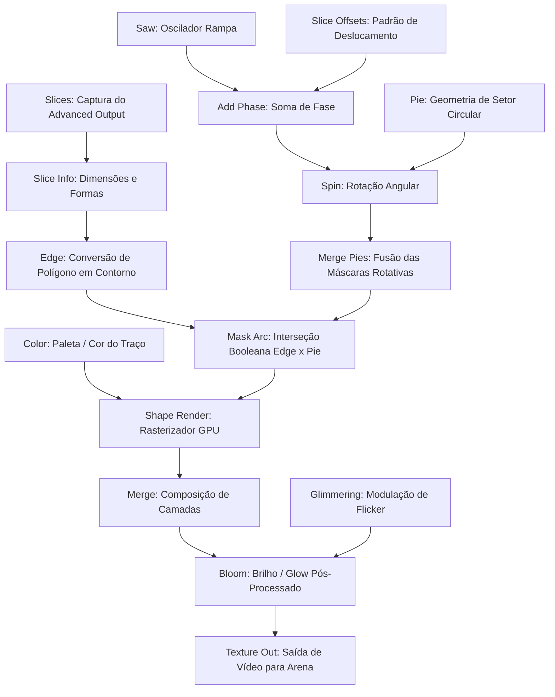

# 02 - Arquitetura de Nodes e Fluxo do Easy Outliner

## 🏛️ Fluxo de Dados do Grafo (Dataflow Graph)

A engenharia reversa do padrão arquitetural do Easy Outliner revelou a seguinte cadeia de nós:

---

## 🧩 Detalhamento dos Nós Principais

| Node | ID de Classe | Papel no Efeito |
| :--- | :--- | :--- |
| **Slices** | `77697265-e61f-42c0-812a-0dca04e74562` | Coleta a geometria de todos os slices ativos no Arena. |
| **Slice Info** | `77697265-39D3-41B8-BECE-237802F83E9F` | Decompõe os slices em shapes vetoriais, centros e bounds. |
| **Edge** | `77697265-ab950887-37ee-4fd2-9487-c856b6b75c83` | Converte o preenchimento do slice em traço perimetral (borda). |
| **Saw** | `77697265-F95F-41D8-8FC4-DF0DC56E1051` | Gerador de rampa cíclica contínua (0 a 1) para o movimento. |
| **Slice Offsets** | `77697265-A48B-4AF9-8975-E3063B037D4C` | Gera defasagem de fase para que os slices não corram todos juntos. |
| **Pie** | `77697265-cd66-44d5-b414-74e8c11c805c` | Gera uma "fatia de pizza" cuja abertura define o comprimento do feixe de luz. |
| **Spin** | `77697265-9225-4009-9D2D-5F898E94CC33` | Gira o setor circular conforme o tempo/fase do Saw. |
| **Mask Arc** | `77697265-48f0-48c6-93df-afe8984d360b` | **O segredo do efeito:** faz a máscara booleana entre a borda retangular e o setor giratório. Somente o ponto onde eles se cruzam fica visível, criando o traçador perimétrico. |
| **Shape Render** | `77697265-EA26-47D6-985A-B4D5DC314BF7` | Converte as curvas matemáticas em textura raster na placa de vídeo. |
| **Bloom** | `77697265-B994-4A9A-94E7-B4E0FA77D8AF` | Adiciona dispersão luminosa (glow neon) sobre as bordas. |

---

## ⚡ Gargalos de Performance Identificados na Versão Cosmowe
1. **Interseção Vetorial CPU/GPU**: O uso de nós de máscara booleana geométrica (`Mask Arc` com `Pie`) recalcula interseções de polígonos. Quando o palco possui mais de 40 slices, isso causa quedas de frame.
2. **Falta de Shader SDF**: Não utiliza distância com sinal (Signed Distance Fields), o que impede cantos arredondados contínuos e transições de degradê suave na cauda do feixe.
3. **Ausência de Reatividade de Áudio Direta**: Depende de parâmetros manuais de velocidade em vez de extração nativa por bandas de frequência (BPM/FFT).
