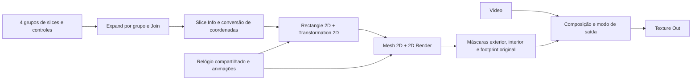

# Arquitetura observada e reconstruída

Original: 308 nós e 445 conexões. Inventário e ligações em evidence/original-graph-analysis.json.
Quatro Slice In alimentam Slice Info; dimension/center/rotation seguem para operações matemáticas,
coleções e retângulos SDF. Map/Switch ajustam controles e modos. As famílias Rectangle, Edge,
Transform, Shape Render, Mask e Merge produzem a saída do efeito. Shape Render já agrega
instâncias em textura escalar: os registros original-live-node-70/88/97.json impedem a alegação
incorreta de N texturas de saída para N slices.

Implementação nova: 233 nós, 331 conexões, construída a partir de um scaffold próprio.
Os controles de cada grupo são expandidos pelo Size da sua coleção antes de Join. Assim,
grupos de tamanhos diferentes mantêm cor, raio, fase e animação alinhados ao slice correto.
Um Slice Info compartilhado fornece os dados geométricos. Conversão pixel→mundo = 2/altura.
Raios físicos independentes são limitados a metade da menor dimensão após o inset.

O stroke padrão é exterior menos interior; os recortes preservam o conteúdo fora dos slices no modo
Refine + Stroke. Inside Slices aplica a máscara arredondada ao vídeo; Outline Only fornece RGBA transparente.
Um ramo SDF explícito conserva contornos internos, com custo maior. Switches de modo usam fluxo attribute.
Zero stroke anula o material para impedir o halo residual A×(1−A) das máscaras antialiased coincidentes.
Zero opacidade e grupo desativado também produzem alpha zero no modo Outline Only.

O novo Chase usa índice global na coleção concatenada e fase por grupo. Breathe varia escala entre
1 e 1−0,2×Motion Amount; Pulse/Chase/Strobe modulam intensidade, Color Flow interpola as cores.
Não há promessa de equivalência entre presets/efeitos proprietários e o novo conjunto.
