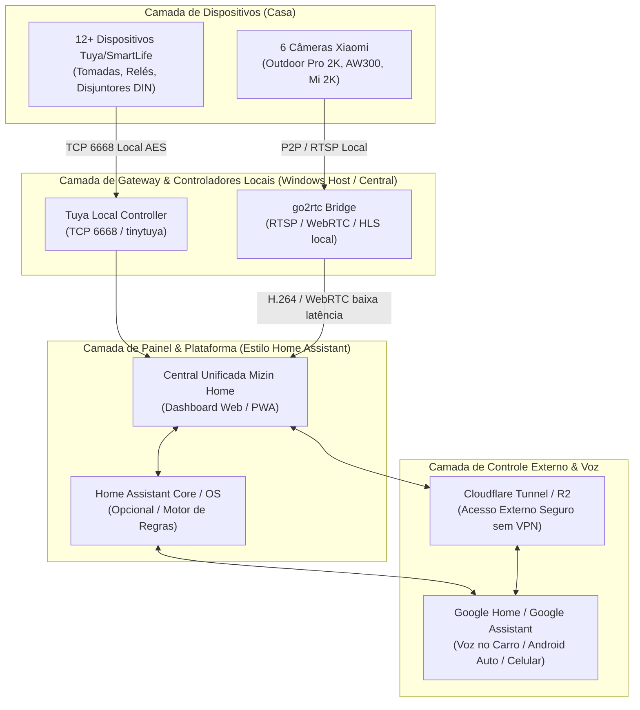

# 02 - Arquitetura de Unificação: Tuya + Xiaomi + Portal + Google Home

## 🏛️ Visão Geral da Arquitetura Unificada

O objetivo é transformar a automação residencial em um sistema centralizado, local, ultrarrápido e livre das instabilidades dos aplicativos em nuvem:

---

## 🔑 Pilares de Implementação

1. **Tuya Local Control**:
   - Controle direto sem passar pelos servidores da China/EUA.
   - Resposta instantânea (< 50ms) para ligar/desligar luzes, disjuntores e tomadas.
   - Leitura de potência, tensão e consumo em tempo real.

2. **Xiaomi Câmeras (Integrado)**:
   - Aproveita a base validada em `targets/xiaomi_home` (Mizin Câmeras).
   - 6 câmeras decodificadas com H.264/WebRTC via go2rtc.

3. **Integração com Google Home (Voz no Carro / Celular)**:
   - Duas vias de ligação:
     - **Via Home Assistant**: Integração nativa Google Assistant (expõe todas as entidades para o app Google Home via Cloudflare Tunnel ou Nabu Casa).
     - **Via Tuya / Smart Life Cloud**: Mantém a vinculação nativa do Tuya com Google Home para os interruptores/disjuntores existentes, enquanto o painel local assume a visualização de alta performance.
